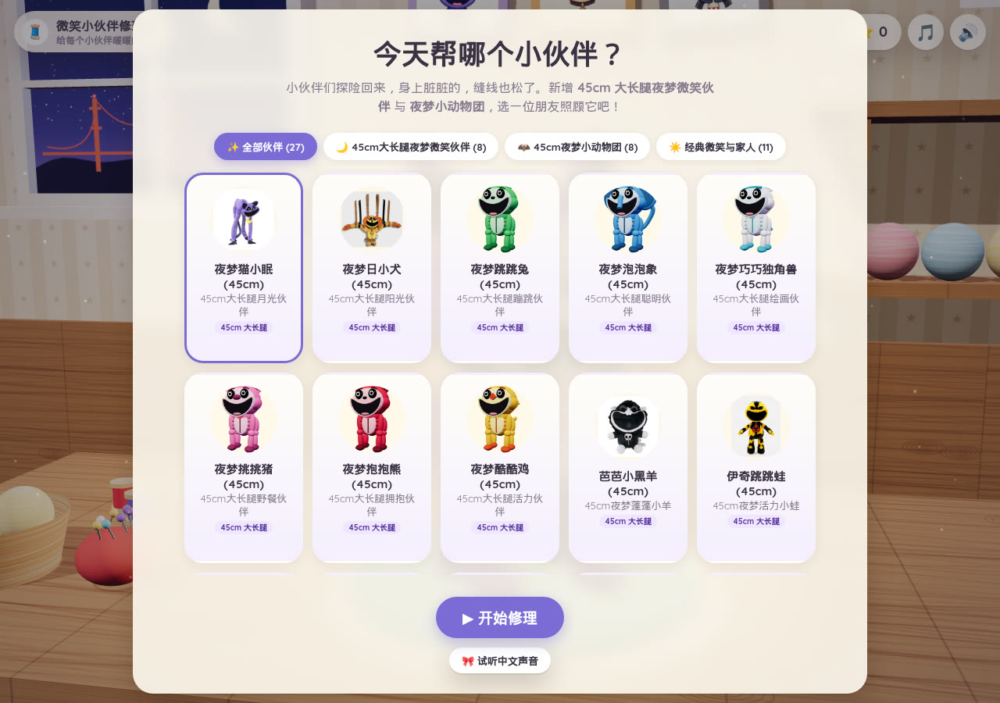

# 🧸 Critter Repair Workshop 3D

A cozy 3D plush-repair clinic for our family's Smiling Critters and Nightmare Smiling Critters, built for a 5-year-old.
Inspired by doll-restoration videos, with only the gentle, satisfying parts kept.

**Play:** https://kunruiw1991.github.io/critters-repair-workshop/

## Patients (27 Total)

### 🌙 45cm Tall Long-Limbed Nightmare Smiling Critters (Quadrupedal Arched-Back Plush)
Modeled after the larger 45cm (17.7in) tall, long-limbed, arched-back 4-legged Monster/Nightmare CatNap plush ([reference](https://qtplushies.com/products/catnap?variant=46189051150393)):

| Critter | Chinese Name | Pendant |
|---|---|---|
| 🌙 Nightmare CatNap (45cm) | 夜梦猫小眠 (45cm) | Crescent Moon |
| ☀️ Nightmare DogDay (45cm) | 夜梦日小犬 (45cm) | Sun |
| ⚡ Nightmare Hoppy Hopscotch (45cm) | 夜梦跳跳兔 (45cm) | Lightning Bolt |
| 💡 Nightmare Bubba Bubbaphant (45cm) | 夜梦泡泡象 (45cm) | Lightbulb |
| 🌼 Nightmare CraftyCorn (45cm) | 夜梦巧巧独角兽 (45cm) | Rainbow Flower |
| 🍎 Nightmare PickyPiggy (45cm) | 夜梦挑挑猪 (45cm) | Red Apple |
| ❤️ Nightmare Bobby BearHug (45cm) | 夜梦抱抱熊 (45cm) | Ruby Heart |
| ⭐ Nightmare KickinChicken (45cm) | 夜梦酷酷鸡 (45cm) | Golden Star |

### 🦇 45cm Tall Nightmare Critters (Quadrupedal Arched-Back Plush)
| Critter | Chinese Name | Pendant |
|---|---|---|
| 💀 Baba Chops (45cm) | 芭芭小黑羊 (45cm) | Silver Skull |
| 🐸 Icky Licky (45cm) | 伊奇跳跳蛙 (45cm) | Biohazard |
| 💧 Rabie Baby (45cm) | 蕾比小蝙蝠 (45cm) | Cyan Teardrop |
| 🦴 Allister Gator (45cm) | 阿利小鳄鱼 (45cm) | Crossbones |
| 🐉 Simon Smoke (45cm) | 赛门小火龙 (45cm) | Gold Dollar |
| ⛈️ Poe (45cm) | 坡坡小乌鸦 (45cm) | Storm Cloud |
| 🐟 Touille (45cm) | 图伊小灰鼠 (45cm) | Fishbone |
| 🦈 Maggie Mako (45cm) | 玛吉小鲨鱼 (45cm) | Shark Tooth |

### ☀️ Classic Smiling Critters & Family Friends
| Critter | Who |
|---|---|
| 🦇 LunaBat | Family friend |
| 🦊 SunnyFox | Mom |
| 🍿 PoppyDash | Dad |
| ☀️ DogDay | Sunshine friend |
| 🌙 CatNap | Moonlight friend |
| ⚡ Hoppy Hopscotch | Bouncy friend |
| 💡 Bubba Bubbaphant | Clever friend |
| 🌼 CraftyCorn | Art-loving friend |
| 🍎 PickyPiggy | Picnic friend |
| ❤️ Bobby BearHug | Cuddly friend |
| ⭐ KickinChicken | Cool friend |

## How it plays
- Filter the patient menu by category (`✨ 全部伙伴 (27)`, `🌙 45cm大长腿夜梦微笑伙伴 (8)`, `🦇 45cm夜梦小动物团 (8)`, `☀️ 经典微笑与家人 (11)`).
- Every visit rolls **random damage** on the 3D plush: mud, dust and cobwebs, prickly burrs, torn seams, plus 3 surprise problems (lost button eye, loose ear, flat stuffing, faded colors, dull pendant).
- Fix things **in any order**. Drag to spin the turntable; tap a ticket chip and the critter turns to show you that spot.
- **13 tools:** 🧹 brush, 🧽 sponge (leaves wet spots), 💨 dryer, 🪡 needle (4 stitches, also sews the ear back), 🔘 button eye, ☁️ cotton, 🖌️ color spray, 🧤 polish, tweezers, 🪮 fluff comb, 🩹 fabric patch, 🩺 stethoscope checkup, and the final 💝 wind-up heart that wakes the critter up.
- Dress-up (bow, flowers, party hat, scarf, star), then the critter hops onto the **Happy Shelf**. Before/after photo card. Shelf and stars are saved on the device.
- Interface and dialogue are in simplified Chinese. All 56 spoken lines are bundled as MP3 recordings using the lively Mandarin Xiaoyi synthetic voice, so playback does not depend on installed device voices.

## Tech
- Three.js r161, no build step, no backend. Open `index.html` from any static host.
- Exact reference paths and source commit are recorded in `icons/smiling-critters-sources.json`.
- `tests/make_batch.py` and `tests/playthrough.cjs` exercise the 3D rigs through repairs, checkup, wake-up, dress-up, shelf save/reload, and mobile controls.
